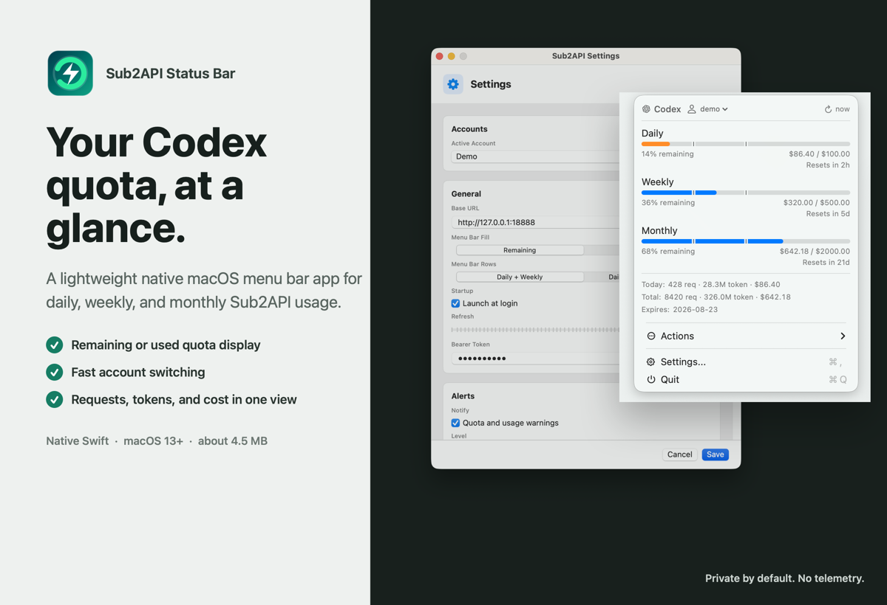
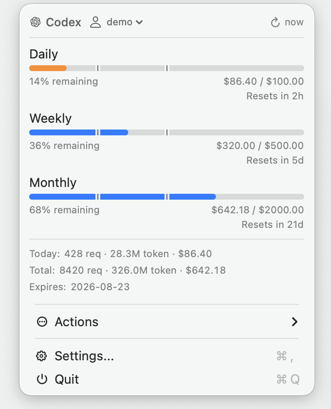
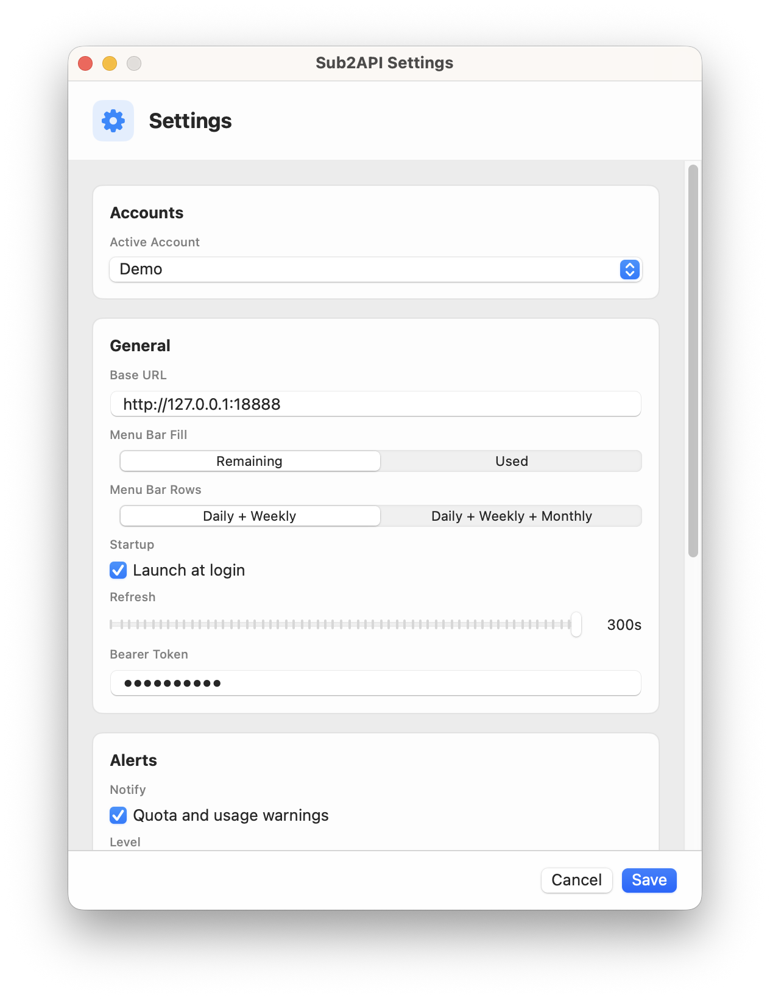

<div align="center">
  
  <h1>Sub2API Status Bar</h1>
  <p>See your Codex quota, requests, tokens, and cost without leaving the macOS menu bar.</p>

  [简体中文](README.zh-CN.md) · English

  
  
  
  [](LICENSE)
</div>



Sub2API Status Bar is a lightweight, native Swift companion for [Sub2API](https://github.com/Wei-Shaw/sub2api). The menu bar icon shows quota pressure at a glance; one click reveals daily and weekly usage, reset times, request counts, token totals, and cost.

## Why Use It?

- **Glanceable quota meter**: no text in the menu bar, just a compact two-row usage meter for daily and weekly quota.
- **Clear usage semantics**: choose whether the solid portion represents remaining or used quota.
- **Useful details, not a dashboard clone**: requests, tokens, cost, reset times, and expiry fit in one compact menu.
- **Fast account switching**: switch saved Sub2API accounts from the first row.
- **Native and small**: SwiftUI/AppKit, no Electron runtime, approximately 4.5 MB.
- **Private by default**: local configuration, no telemetry, and no third-party analytics.

## Screenshots

<p align="center">
  
  &nbsp;&nbsp;
  
</p>

The progress markers represent 50% and 75% used quota. In Remaining mode those thresholds are mirrored to 50% and 25% remaining.

## Install

### Download

Published `.dmg` and `.zip` builds are available from [GitHub Releases](https://github.com/Kaijun/Sub2APIStatusBar/releases). If no release is listed yet, use the source build below. Move `Sub2APIStatusBar.app` to Applications after downloading or building it.

Because locally built or ad-hoc signed releases may not be notarized, macOS can require **System Settings > Privacy & Security > Open Anyway** on first launch.

Releases are built automatically when a `v*` tag is pushed. Builds use Apple signing and notarization when the repository secrets are configured; otherwise, the workflow publishes an ad-hoc signed build with the first-launch notice above.

### Build From Source

Requirements: macOS 13 or later and Swift 6.0 or later.

```bash
git clone https://github.com/Kaijun/Sub2APIStatusBar.git
cd Sub2APIStatusBar
swift run Sub2APIStatusBar
```

To build a standalone app:

```bash
VERSION=v0.1.12 ./scripts/build-app.sh
open dist/Sub2APIStatusBar.app
```

## Connect Your Server

Open **Settings → Add Account / Sign In**, enter your server URL (for example `https://sub2api.example.com`), email, and password, then click **Login**. Saved accounts are listed in **Accounts**, with **Use** and **Remove** actions. Removing an account deletes its locally saved tokens and password; it does not delete the server account. Account changes and logins are saved immediately.

Enable **Remember password and sign in automatically** to save your login in macOS Keychain. When a request returns HTTP 401, the app signs in again with the saved email and password, even without a refresh token. This setting persists across app restarts. Rejected logins pause automatic attempts until you sign in manually again. Use **Forget Saved Password** to remove the saved login and disable this behavior.

The login window is also available from **Actions → Accounts → Add Account…**, or **Actions → Add Account…** when no accounts are saved. Manual **Bearer Token** configuration remains available; without password-based automatic login, session renewal requires a refresh token.

Set your preferred refresh interval and menu bar display mode in Settings.

The app expects these `/api/v1` endpoints:

```text
POST /auth/login
POST /auth/refresh
GET /auth/me
GET /subscriptions/summary
GET /usage/dashboard/stats
GET /usage/dashboard/trend
GET /usage/dashboard/models
```

Requests include `Authorization: Bearer <token>`.

Optional environment variables are useful for first-run development:

```bash
SUB2API_BASE_URL=https://sub2api.example.com \
SUB2API_AUTH_TOKEN=your-token \
SUB2API_MENU_BAR_USAGE=remaining \
swift run Sub2APIStatusBar
```

## What You Can Configure

| Setting | Options |
| --- | --- |
| Menu Bar Fill | Remaining or Used |
| Usage Data Refresh | Poll quota, requests, tokens, and cost every 5 to 300 seconds; separate from login renewal |
| Accounts | Save, switch, and remove multiple Sub2API accounts |
| Alerts | Quota and usage warnings with severity and cooldown controls |
| Startup | Launch automatically at login |

## Privacy

The app talks only to your configured Sub2API server and GitHub Releases for update checks. It does not include telemetry or third-party analytics.

Configuration is stored locally at:

```text
~/Library/Application Support/Sub2APIStatusBar/config.json
```

Authentication tokens remain in that local configuration file; protect it as you would any credential. Saved logins for automatic sign-in use macOS Keychain. Passwords are never written to `config.json`.

## Development

```bash
swift build
swift test
./scripts/capture-product-preview.swift
VERSION=v0.1.12 ./scripts/package-release.sh
```

To publish a GitHub Release:

```bash
git tag v0.1.12
git push origin v0.1.12
```

See [CONTRIBUTING.md](CONTRIBUTING.md) for contribution guidance and [SECURITY.md](SECURITY.md) for private vulnerability reporting.

## Acknowledgements

The compact quota presentation is inspired by [CodexBar](https://github.com/steipete/CodexBar). See [THIRD_PARTY_NOTICES.md](Resources/THIRD_PARTY_NOTICES.md) for attribution. Thanks to the [LinuxDo](https://linux.do/) community for its discussions and feedback.

## License

[MIT](LICENSE)
