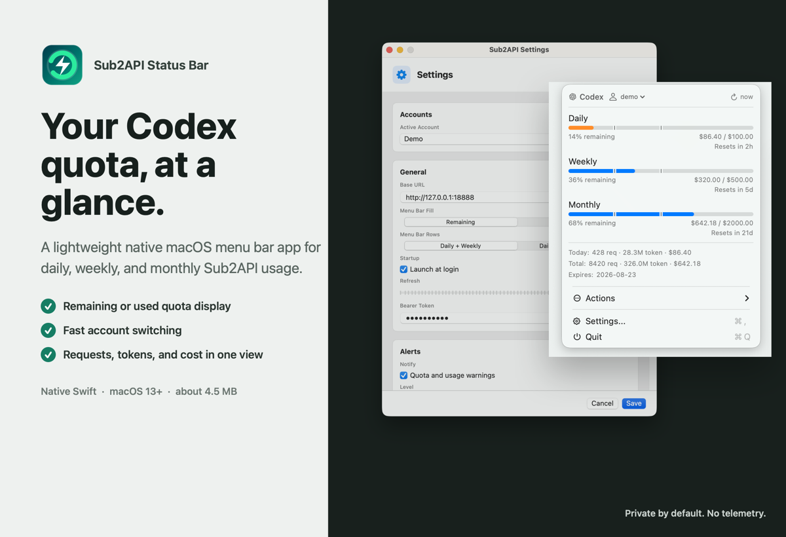
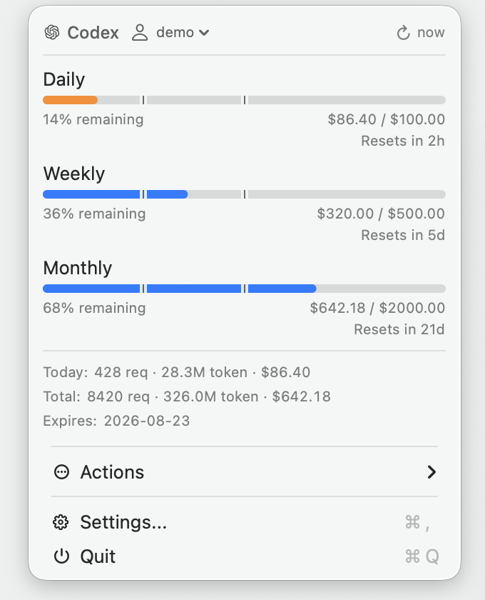
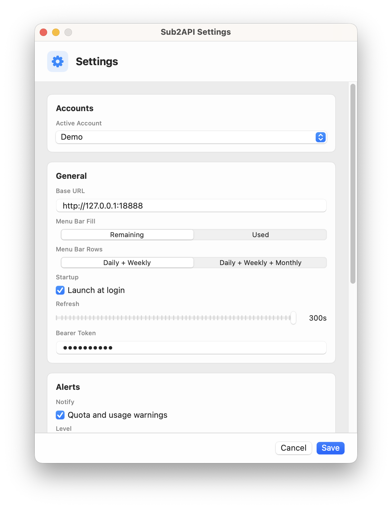

<div align="center">
  
  <h1>Sub2API Status Bar</h1>
  <p>无需打开控制台，在 macOS 菜单栏随时查看 Codex 额度、请求、Token 和费用。</p>

  简体中文 · [English](README.md)

  
  
  
  [](LICENSE)
</div>



Sub2API Status Bar 是一款使用原生 Swift 开发的轻量级 [Sub2API](https://github.com/Wei-Shaw/sub2api) 菜单栏工具。菜单栏图标可以快速反映额度压力；点开后即可查看每天、每周、每月额度，以及重置时间、请求数、Token、费用和订阅到期时间。

## 为什么值得用？

- **一眼看懂额度**：菜单栏不显示文字，只保留紧凑的两栏或三栏用量计。
- **显示方式明确**：可以选择实心部分代表“剩余”或“已用”。
- **信息够用但不臃肿**：请求、Token、费用、重置时间和到期时间集中在一个小菜单里。
- **多账号快速切换**：直接点击第一行用户名即可切换已保存的 Sub2API 账号。
- **原生且轻量**：SwiftUI/AppKit 实现，无 Electron 运行时，应用约 4.5 MB。
- **默认保护隐私**：配置保存在本地，无遥测、无第三方分析。

## 界面预览

<p align="center">
  
  &nbsp;&nbsp;
  
</p>

进度条刻度代表已用额度达到 50% 和 75%。选择 Remaining 时，对应刻度会镜像为剩余 50% 和 25%。

## 安装

### 下载应用

已发布的 `.dmg` 和 `.zip` 会出现在 [GitHub Releases](https://github.com/Kaijun/Sub2APIStatusBar/releases)。如果页面暂时没有 Release，请使用下面的源码构建方式。下载或构建完成后，把 `Sub2APIStatusBar.app` 移入 Applications。

本地构建或 ad-hoc 签名的版本可能未经过 Apple 公证。首次启动被阻止时，可以前往 **系统设置 > 隐私与安全性 > 仍要打开**。

推送 `v*` 标签后，GitHub Actions 会自动构建并发布 Release。仓库配置了 Apple 密钥时会签名并公证；未配置时会发布 ad-hoc 签名版本，并在 Release 页面提示上述首次打开方法。

### 从源码运行

需要 macOS 13 或更高版本，以及 Swift 6.0 或更高版本。

```bash
git clone https://github.com/Kaijun/Sub2APIStatusBar.git
cd Sub2APIStatusBar
swift run Sub2APIStatusBar
```

构建独立应用：

```bash
VERSION=v0.1.12 ./scripts/build-app.sh
open dist/Sub2APIStatusBar.app
```

## 连接 Sub2API

打开 **Settings**，填写：

- **Base URL**，例如 `https://sub2api.example.com`
- 当前 Sub2API 账号的 **Bearer Token**
- 刷新间隔和菜单栏显示方式

应用会访问以下 `/api/v1` 接口：

```text
GET /auth/me
GET /subscriptions/summary
GET /usage/dashboard/stats
GET /usage/dashboard/trend
GET /usage/dashboard/models
```

请求会携带 `Authorization: Bearer <token>`。

开发环境首次运行时也可以使用环境变量：

```bash
SUB2API_BASE_URL=https://sub2api.example.com \
SUB2API_AUTH_TOKEN=your-token \
SUB2API_MENU_BAR_USAGE=remaining \
SUB2API_MENU_BAR_ROWS=two \
swift run Sub2APIStatusBar
```

## 可配置项目

| 设置 | 选项 |
| --- | --- |
| Menu Bar Fill | Remaining 或 Used |
| Menu Bar Rows | Daily + Weekly 或 Daily + Weekly + Monthly |
| Refresh | 5 至 300 秒 |
| Accounts | 保存并切换多个 Sub2API 账号 |
| Alerts | 额度和用量提醒，可设置级别与静默时间 |
| Startup | 登录 macOS 后自动启动 |

## 隐私

应用只会访问你配置的 Sub2API 服务器，并通过 GitHub Releases 检查更新。它不包含遥测或第三方分析。

配置保存在本地：

```text
~/Library/Application Support/Sub2APIStatusBar/config.json
```

当前实现会把认证 Token 存在本地配置文件中，而不是 macOS Keychain。请像保护其他凭据一样保护该文件。

## 开发

```bash
swift build
swift test
./scripts/capture-product-preview.swift
VERSION=v0.1.12 ./scripts/package-release.sh
```

发布 GitHub Release：

```bash
git tag v0.1.12
git push origin v0.1.12
```

贡献说明请查看 [CONTRIBUTING.md](CONTRIBUTING.md)，安全问题请通过 [SECURITY.md](SECURITY.md) 中的方式私下报告。

## 鸣谢

紧凑额度展示的视觉方向参考了 [CodexBar](https://github.com/steipete/CodexBar)，具体声明见 [THIRD_PARTY_NOTICES.md](Resources/THIRD_PARTY_NOTICES.md)。感谢 [LinuxDo](https://linux.do/) 社区的讨论、分享和反馈。

## 许可证

[MIT](LICENSE)
